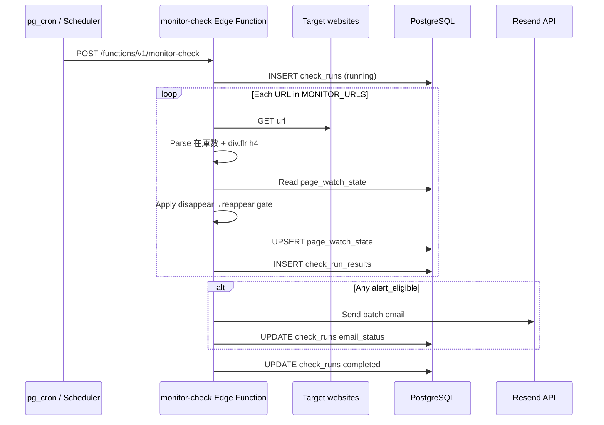

# Implementation Plan: Website Keyword Monitor

**Branch**: `001-website-keyword-monitor` | **Date**: 2026-06-04 | **Spec**: [spec.md](./spec.md)

**Input**: Feature specification from `/specs/001-website-keyword-monitor/spec.md`  
**Plan scope**: `specs/001-website-keyword-monitor` (user path `specs\001-website-keyword-monitor`)

## Summary

Build a scheduled monitor on **Supabase** that runs as an **Edge Function**, fetches a deploy-time URL list, detects **在庫数** on each page, extracts text from **`div.flr > h4`**, and sends a **batched email** when pages newly qualify. **PostgreSQL** stores per-URL watch state so the operator is **not spammed** while the keyword remains; a **new email is sent only after the keyword disappears and later reappears** on that URL (plan decision aligning with user input; supersedes spec excerpt-diff for v1).

## Technical Context

**Language/Version**: TypeScript on Deno (Supabase Edge Functions runtime)

**Primary Dependencies**: `@supabase/supabase-js`, `linkedom` (HTML parse), **Resend** (`resend` SDK or REST) for all alert email

**Storage**: Supabase PostgreSQL — `monitored_pages`, `page_watch_state`, `check_runs`, `check_run_results`

**Testing**: Deno test for pure parsers/dedup logic; manual/curl integration against local `supabase functions serve`; optional pgTAP for migrations

**Target Platform**: Supabase Edge Functions + hosted Postgres; scheduled via `pg_cron` + `pg_net` or Supabase cron

**Project Type**: Serverless backend (no frontend)

**Performance Goals**: Full run for ≤10 URLs within 60s (per SC-002); per-fetch timeout default 15s

**Constraints**: Edge Function CPU/time limits; public HTTP fetch only (no auth); UTF-8 Japanese keyword matching

**Scale/Scope**: Single operator deployment; ≤10 URLs; hourly default schedule

## Constitution Check

*GATE: Must pass before Phase 0 research. Re-check after Phase 1 design.*

| Gate | Status | Notes |
|------|--------|-------|
| Constitution ratified | **N/A** | `.specify/memory/constitution.md` is still a template — no project-specific gates |
| Simplicity | **Pass** | One Edge Function + 3 tables + env config |
| Testability | **Pass** | Dedup state machine and HTML extractor unit-testable |
| Observability | **Pass** | Structured run/result tables per FR-011 |

**Post-design re-check**: Pass — no additional services beyond Supabase + email provider.

## Project Structure

### Documentation (this feature)

```text
specs/001-website-keyword-monitor/
├── plan.md              # This file
├── research.md          # Phase 0
├── data-model.md        # Phase 1
├── quickstart.md        # Phase 1
├── contracts/           # Phase 1
│   ├── monitor-check.openapi.yaml
│   ├── alert-email.schema.json
│   └── README.md
└── tasks.md             # Phase 2 (/speckit-tasks — not created here)
```

### Source Code (repository root)

```text
supabase/
├── config.toml
├── migrations/
│   └── 20260604000000_monitor_schema.sql
└── functions/
    └── monitor-check/
        ├── index.ts           # HTTP handler, orchestration
        ├── pages.ts           # load enabled rows from monitored_pages
        ├── fetch-page.ts      # fetch + timeout
        ├── parse-inventory.ts # 在庫数 + div.flr h4 extraction
        ├── dedup.ts           # disappear→reappear logic
        ├── email.ts           # Resend batch send + retries
        └── db.ts              # Supabase client helpers

tests/
└── monitor-check/
    ├── parse-inventory.test.ts
    └── dedup.test.ts
```

**Structure Decision**: Standard Supabase layout under `supabase/`; business logic split into testable modules inside the single Edge Function.

## Architecture



## Phase 0: Research

Completed — see [research.md](./research.md). All Technical Context items resolved; no outstanding NEEDS CLARIFICATION.

**Spec alignment note**: User Story 2 in spec mentions `<h4>` text change triggering re-alert. **v1 implementation uses disappear→reappear only** (per plan/research). Excerpt-change alerts are deferred.

## Phase 1: Design

| Artifact | Path |
|----------|------|
| Data model | [data-model.md](./data-model.md) |
| API contract | [contracts/monitor-check.openapi.yaml](./contracts/monitor-check.openapi.yaml) |
| Email payload | [contracts/alert-email.schema.json](./contracts/alert-email.schema.json) |
| Operator guide | [quickstart.md](./quickstart.md) |

### Implementation highlights

1. **Migration**: Create tables including `monitored_pages` with seed rows for the two OFG URLs; RLS disabled for service-role writes from Edge Function (or RLS policies allowing service role only).
2. **Edge Function `monitor-check`**:
   - Verify `x-monitor-secret`
   - Load enabled URLs from `monitored_pages` table
   - For each URL: fetch → parse → load `page_watch_state` → compute `alert_eligible`
   - Batch eligible URLs into one email (FR-009)
   - Update `notified_while_present` only when email send succeeds (or on dry-run skip)
3. **Dedup** (`dedup.ts`): If `keyword_present` was true and still true → skip. If was true and now false → reset `notified_while_present`. If was false and now true with structure → eligible.
4. **Email (Resend)**: Map `alert-email.schema.json` matches to one Resend message (HTML + plain text); 3 delivery retries with exponential backoff on 5xx/rate-limit (FR edge case / research R6).
5. **Cron**: SQL migration enabling `pg_cron` + `pg_net` to POST function URL hourly (or document Dashboard cron in quickstart).

### Environment variables / secrets

| Name | Required | Description |
|------|----------|-------------|
| `SUPABASE_URL` | yes | Auto-injected |
| `SUPABASE_SERVICE_ROLE_KEY` | yes | Auto-injected |
| `ALERT_EMAIL` | yes | Recipient |
| `RESEND_API_KEY` | yes | Email provider |
| `RESEND_FROM` | yes | Verified sender |
| `MONITOR_CRON_SECRET` | yes | Shared secret for invoke |
| `FETCH_TIMEOUT_MS` | no | Default 15000 |

## Phase 2: Tasks

Not generated by `/speckit-plan`. Run **`/speckit-tasks`** to produce `tasks.md`.

## Complexity Tracking

No constitution violations requiring justification.
