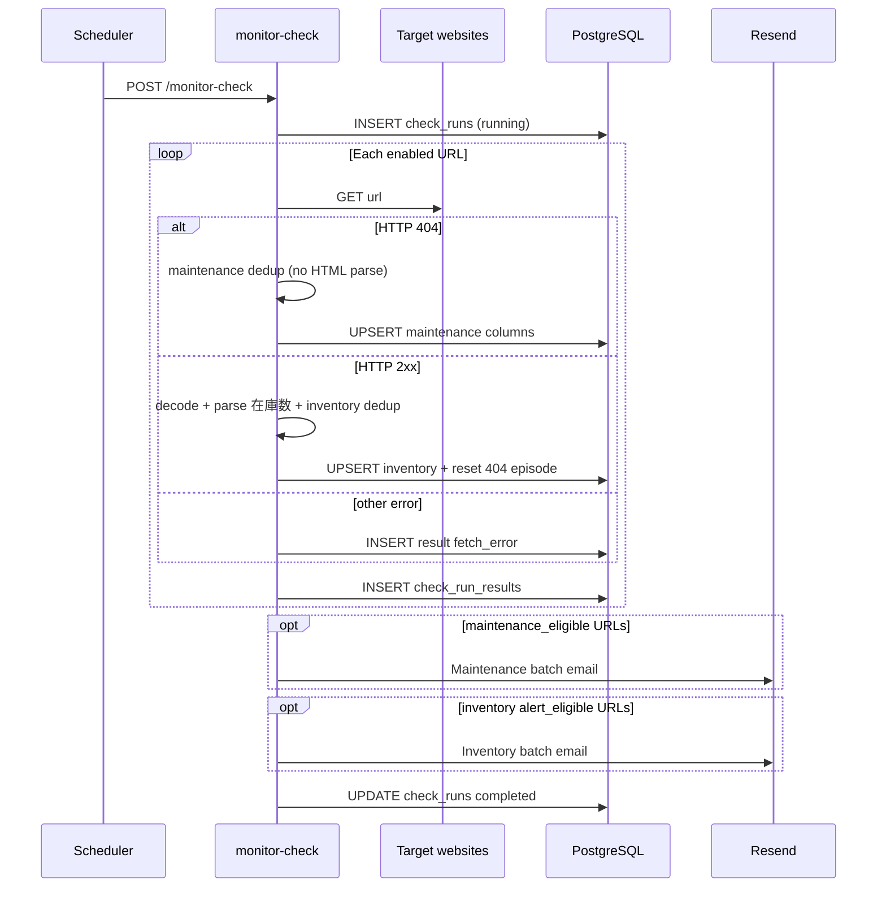

# Implementation Plan: Maintenance 404 Alert

**Branch**: `002-404-maintenance-alert` | **Date**: 2026-06-05 | **Spec**: [spec.md](./spec.md)

**Input**: Feature specification from `/specs/002-404-maintenance-alert/spec.md`  
**Depends on**: `001-website-keyword-monitor` (deployed `monitor-check` Edge Function)

## Summary

Extend the existing **`monitor-check`** Edge Function to detect **HTTP 404** on monitored URLs as a **maintenance / coming-soon** signal, send a **distinct batched email** (separate from 在庫数 inventory alerts), and **deduplicate** with the same **disappear → reappear** episode model: notify once per 404 episode, suppress while still 404, notify again only after the page recovers (HTTP 2xx) and later returns 404.

## Technical Context

**Language/Version**: TypeScript on Deno (Supabase Edge Functions runtime)

**Primary Dependencies**: Existing `@supabase/supabase-js`, `linkedom`, `iconv-lite`; **Resend** for both email types

**Storage**: Extend PostgreSQL tables from 001 — `page_watch_state`, `check_runs`, `check_run_results` (additive migration)

**Testing**: Deno unit tests for `dedup-maintenance.ts`; extend integration dry-run via curl; fixture tests for 404 vs 2xx fetch branches

**Target Platform**: Same Supabase Edge Function + existing cron schedule (no new scheduler)

**Project Type**: Serverless backend extension (no frontend)

**Performance Goals**: No additional fetch per URL; same ≤60s run budget for ≤10 URLs (SC-006)

**Constraints**: 404-only for v1; no HTML parse on 404 responses; episode recovery requires HTTP 2xx

**Scale/Scope**: Same operator deployment; ≤10 URLs; extends 001 without new env vars

## Constitution Check

*GATE: Must pass before Phase 0 research. Re-check after Phase 1 design.*

| Gate | Status | Notes |
|------|--------|-------|
| Constitution ratified | **N/A** | `.specify/memory/constitution.md` is still a template |
| Simplicity | **Pass** | Extends one function + additive columns; reuses dedup pattern |
| Testability | **Pass** | Maintenance dedup is pure function; fetch status branch unit-testable |
| Observability | **Pass** | Extended `check_run_results` columns per FR-010 |

**Post-design re-check**: Pass — no new services; dual email is two Resend calls max per run.

## Project Structure

### Documentation (this feature)

```text
specs/002-404-maintenance-alert/
├── plan.md              # This file
├── research.md          # Phase 0
├── data-model.md        # Phase 1
├── quickstart.md        # Phase 1
├── contracts/           # Phase 1
│   ├── monitor-check.openapi.yaml
│   ├── maintenance-email.schema.json
│   └── README.md
└── tasks.md             # Phase 2 (/speckit-tasks — not created here)
```

### Source Code (repository root)

```text
supabase/
├── migrations/
│   └── 20260605000000_maintenance_404_schema.sql   # NEW
└── functions/
    └── monitor-check/
        ├── index.ts              # Branch on HTTP status; dual email sends
        ├── fetch-page.ts         # Return http status (404 vs 2xx vs error)
        ├── dedup-maintenance.ts  # NEW — 404 episode gate
        ├── email.ts              # + sendMaintenanceEmail()
        ├── db.ts                 # Extended state/result/run helpers
        └── types.ts              # Extended interfaces

tests/
└── monitor-check/
    ├── dedup-maintenance.test.ts   # NEW
    └── (existing parse/dedup tests unchanged)
```

**Structure Decision**: All changes stay inside existing `monitor-check` function and migration path from 001.

## Architecture



## Phase 0: Research

Completed — see [research.md](./research.md). All Technical Context items resolved; no outstanding NEEDS CLARIFICATION.

## Phase 1: Design

| Artifact | Path |
|----------|------|
| Data model | [data-model.md](./data-model.md) |
| API contract | [contracts/monitor-check.openapi.yaml](./contracts/monitor-check.openapi.yaml) |
| Maintenance email | [contracts/maintenance-email.schema.json](./contracts/maintenance-email.schema.json) |
| Operator guide | [quickstart.md](./quickstart.md) |

### Implementation highlights

1. **Migration** (`20260605000000_maintenance_404_schema.sql`):
   - `page_watch_state`: `maintenance_404_present`, `notified_while_404`
   - `check_runs`: `maintenance_urls_alerted`, `maintenance_email_status`
   - `check_run_results`: `http_status`, `maintenance_detected`, `maintenance_eligible`, `maintenance_sent`, `maintenance_skip_reason`

2. **`fetch-page.ts`**:
   - Return `status: number | null` on all outcomes
   - `ok: true` only for 2xx; `status: 404` with `ok: false` and `body: null` (no decode/parse)
   - Other `!ok` retain error message with status when available

3. **`dedup-maintenance.ts`** (mirror `dedup.ts`):
   - Input: `previous.maintenance_404_present`, `previous.notified_while_404`, `now404: boolean`
   - Output: `maintenance404Present`, `notifiedWhile404`, `maintenanceEligible`, `skipReason`
   - Recovery path: when `now404=false` and previous was 404 → reset both flags

4. **`index.ts` orchestration**:
   ```
   if status === 404 → maintenance path only
   else if ok (2xx) → inventory path + maintenance recovery reset
   else → fetch_error, preserve maintenance state
   ```
   - Send maintenance email batch before or after inventory batch (independent)
   - Advance `notified_while_404` only on successful Resend send
   - Response JSON adds `maintenance_urls_alerted`, `maintenance_email_status`

5. **`email.ts`**:
   - `sendMaintenanceEmail(config, urls: {url, label?}[])`
   - Subject: `[メンテナンス] {n} page(s) may open for sale soon`
   - Body: URL list + short maintenance framing (HTML + plain text)
   - Same retry policy as inventory email

6. **Tests**:
   - `dedup-maintenance.test.ts`: episode enter, suppress while 404, recovery, re-enter
   - Optional: extend fetch mock tests for status branching

### Environment variables / secrets

Unchanged from 001 — no new secrets.

| Name | Required | Description |
|------|----------|-------------|
| `ALERT_EMAIL` | yes | Recipient for both email types |
| `RESEND_API_KEY` | yes | Resend API |
| `RESEND_FROM` | no | Defaults to onboarding sender |
| `MONITOR_CRON_SECRET` | yes | Invoke auth |

## Phase 2: Tasks

Not generated by `/speckit-plan`. Run **`/speckit-tasks`** to produce `tasks.md`.

## Complexity Tracking

No constitution violations requiring justification.
